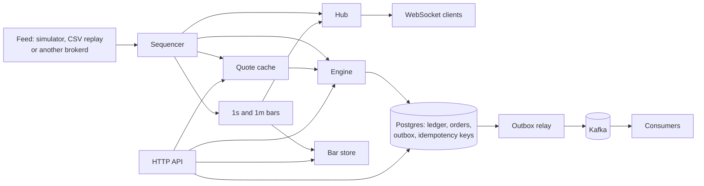

# brokerd

A brokerage backend in Go, run as a paper-trading system: a double-entry
ledger in Postgres, a market data pipeline, an order engine that fills
against live quotes, an HTTP and WebSocket API, and every posting and fill
published to Kafka through a transactional outbox. The interesting parts
are the ones a real broker can't get wrong: money that always balances,
orders that can't fill twice or after they're canceled, retries that are
always safe, events that are never lost, and a market data stream where a
slow client can only hurt itself.



## Status

Done:

- Ledger: brokerage accounts holding USD cash and fractional share positions
  in Postgres. Deposits and withdrawals that go through a bank transfer
  lifecycle, holds for open orders, trade fills (including partial fills)
  with fees, SEC and FINRA regulatory fees on sells, T+1 settlement of sale
  proceeds, tax lots with realized gains and losses, reversals, balances,
  account history and a reconcile command.
- Market data: a seeded random-walk simulator and CSV replay, per-symbol
  sequence checks, a lock-free latest-quote cache, 1s and 1m OHLCV bars by
  event time, a WebSocket stream that drops and then disconnects slow
  clients, and a relay that streams from another brokerd.
- Paper trading: market and limit orders, day and GTC, filled against the
  latest quotes, with holds, cancels, expiry at the close, a market calendar
  for T+1 settlement, and positions with average cost and unrealized gains.
- API and operations: REST endpoints with per-account API keys, safe retries
  with `Idempotency-Key`, one JSON error format, request IDs, structured
  logs, health and readiness checks, Prometheus metrics, an OpenAPI spec,
  graceful shutdown, Docker, and a load test.
- Events: every journal entry and fill written to an outbox in the same
  transaction, published to Kafka in order by one relay at a time, and
  consumed once per event.

Planned:

- Order book and matching engine, risk checks, corporate actions

## Quick start

```bash
make run    # Postgres, migrations and brokerd on :8080 (set BROKERD_PORT to change it)
```

The compose setup sets the regulatory fees to zero so sells work out of the
box. Market orders only fill while the market is open, 09:30 to 16:00 New
York time on trading days; at other times they're rejected. Then, in
another terminal:

```bash
curl -s -X POST localhost:8080/v1/accounts
# {"account":{"id":"...","number":"...","status":"active",...},"api_key":"bk_..."}
ACCOUNT=...
AUTH="Authorization: Bearer bk_..."

curl -s -X POST localhost:8080/v1/accounts/$ACCOUNT/deposits -H "$AUTH" \
  -H "Idempotency-Key: deposit-1" -d '{"amount":"10000"}'
curl -s -X POST localhost:8080/v1/accounts/$ACCOUNT/orders -H "$AUTH" \
  -d '{"symbol":"AAPL","side":"buy","type":"market","time_in_force":"day","qty":"10"}'
curl -s -X POST localhost:8080/v1/accounts/$ACCOUNT/orders -H "$AUTH" \
  -d '{"symbol":"AAPL","side":"sell","type":"limit","time_in_force":"gtc","qty":"5","limit_price":"999"}'
curl -s localhost:8080/v1/accounts/$ACCOUNT/positions -H "$AUTH"
curl -s localhost:8080/v1/accounts/$ACCOUNT/activities -H "$AUTH"
curl -s localhost:8080/v1/quotes/AAPL
curl -s "localhost:8080/v1/bars/AAPL?timeframe=1m"
```

Every posting and fill also goes through Kafka; `docker compose logs -f
outbox-consumer` shows each event once.

And the stream, with any WebSocket client:

```bash
websocat ws://localhost:8080/v1/stream
{"action":"subscribe","quotes":["AAPL"],"bars":["AAPL"]}
```

## API

The endpoints are described in [openapi.yaml](openapi.yaml), which a test
checks against the server's routes.

- Opening an account returns its API key, once. Only its SHA-256 is stored.
  Everything under `/v1/accounts/{account}` needs that account's key; a key
  for another account gets 404, so keys can't be used to find accounts.
- Every request that changes an account takes an `Idempotency-Key`, scoped
  to that account. The first request with a key claims it in a short
  transaction, under an advisory lock on the key, runs, and stores its
  response; a retry gets the stored response back with
  `Idempotent-Replayed: true`. A retry while the first is still running gets
  409, and the same key with a different request gets 422. A 5xx, or a
  request whose client went away, isn't stored, so it can be retried. A
  claim left by a crashed server can be taken over after a minute. A
  handler gets 5s less than the server's write timeout, and at most 30s,
  so one that's just slow stops with a 503, which still gets written, and
  gives its key back before the lease is up, rather than run twice. Keys are
  kept for a day in a table partitioned by day, so old keys go by dropping a
  partition. The key is also passed down as the ledger's idempotency key, or,
  hashed to fit, as an order's client order ID, so even a retry that runs
  again can't move money twice.
- Opening an account refuses an `Idempotency-Key`. There's no account yet
  to scope it to, so the stored response, API key included, would be
  replayed to anyone sending the same key.
- Errors are always `{"error": {"code", "message", "request_id"}}`, with the
  status and code chosen from the domain error. Internal errors don't say
  what went wrong; the log does, under the same request ID.
- Each request gets an `X-Request-Id`, the client's if it sent a valid one,
  and one structured log line. `/healthz` says the process is up; `/readyz`
  checks the database and says 503 once shutdown starts. `/metrics` has
  Prometheus metrics: events per second, sequence gaps, hub drops and
  disconnects, place-to-fill and ledger post latency, orders that failed
  to expire, and request latency by route.
- On SIGTERM, brokerd reports not ready and keeps serving for
  `-drain-delay` (5s), so a load balancer's readiness checks see the 503
  and stop sending it requests. Then it stops taking requests and finishes
  the ones in flight while quotes still flow, stops the feed and the
  engine, closes the WebSocket clients, and closes the database pool last.

## Ledger

Every change is a journal entry whose lines sum to zero for each asset. Each
account has one ledger row per asset it holds, carrying the balance. Customer
accounts sit on one side; the system accounts `external_bank`, `clearing`,
`fees`, `deficits`, `sec_fee_payable` and `taf_payable` (rows in the same
`accounts` table) sit on the other.

| Operation         | Lines                                                                                   |
|-------------------|-----------------------------------------------------------------------------------------|
| Deposit X         | external_bank -X, customer +X                                                           |
| Withdraw X        | customer -X, external_bank +X                                                           |
| Deposit returned  | external_bank +X, customer -X                                                           |
| Buy q @ p, fee f  | customer USD -(n+f), clearing USD +n, fees +f, clearing SYM -q, customer SYM +q         |
| Sell q @ p, fee f | customer SYM -q, clearing SYM +q, clearing USD -n, customer USD +(n-f-s-t), fees +f,    |
|                   | sec_fee_payable +s, taf_payable +t                                                      |
| Reversal          | every line of the reversed entry, negated                                               |
| Deficit d         | deficits -d, customer USD +d                                                            |

`n` is `q * p` rounded half-to-even to the cent. `s` and `t` are the SEC fee
and FINRA's trading activity fee (TAF).

Some notes on how it works:

- Money is `shopspring/decimal` in Go and `NUMERIC(38,9)` in Postgres. Each
  asset has a scale: 2 for USD, 9 for fractional shares, 0 for symbols that
  only trade in whole shares.
- Writes lock the ledger rows they touch with `SELECT ... FOR NO KEY UPDATE`
  and check the available balance under the lock. Rows are always locked in
  the same order (customer rows, then system rows, by id), so concurrent
  writes don't deadlock.
- Accounts are active, restricted or closed. A restricted account can still
  receive deposits and settle orders it already placed, but can't withdraw or
  place new holds. Closing needs every balance and hold at zero, and every
  status change is recorded with a reason.
- Every write locks its account's row first (`FOR NO KEY UPDATE`) and holds
  it until commit, so one account's writes go one at a time and can't
  deadlock with each other, and a close waits for postings in flight.
  Different accounts still write in parallel. Each entry also takes the
  account's next activity number from that row, so the numbers follow
  commit order, and paging through activity, or polling it for what's new,
  can't skip an entry that committed late. Entry ids can't do that: they're
  taken before the locks.
- A hold reserves cash or shares for an open order (`available = balance -
  held`). Each fill takes its cost out of the hold with a conditional update,
  so concurrent fills queue on the hold and can't use more than is left. What
  the fills don't use is released when the order is done or canceled.
- Deposits and withdrawals are transfers. They stay pending until the bank
  confirms them, and a pending withdrawal holds its cash. Bank events
  (completed, canceled, returned) are compare-and-sets on the transfer's
  status, so a repeated event changes nothing and a cancel and a completion
  can't both win.
- Some entries have to be booked even when the customer can't pay: a
  returned deposit that was already spent, the fill of a resting sell whose
  fees turn out to be more than it brings in, or the reversal of a sale
  whose proceeds were spent. The customer pays what cash they have, a
  deficit entry from the `deficits` account covers the rest, and the
  account is restricted. A sell that would fill as it's placed is rejected
  instead, since the customer can still be told no. The deficit is
  its own entry, so a fill still matches its trade and a reversal still
  mirrors what it reverses. Covering a shortfall takes the account's row
  exclusively, so the cash it reads can't change before the entry posts.
- Transfer requests, holds and fills take an idempotency key, scoped to
  the account and the operation, so a client's transfer key can't collide
  with the engine's `order:<id>` hold or `fill:<id>` fill keys. Retrying a
  request returns the original result; reusing a key for a different
  request is an error.
- Fills are booked on the trade date. A sell's proceeds can be traded with
  right away but stay unsettled, and can't be withdrawn, until their
  settlement date. `brokerd settle` settles everything due; each settlement is
  a compare-and-set on its status, so runs can repeat or overlap safely. The
  settlement date comes with the fill from whoever executed the trade.
- Sells pay the SEC fee (per dollar sold) and TAF (per share sold, capped
  per trade) at the rates in effect on the trade date, each rounded up to
  the cent. Rates are loaded with `brokerd fee-rate` from the published
  schedules, and a sell with no rate in effect fails rather than charging
  nothing. Each entry records the rates it was charged, and the idempotency
  key covers the fill as requested, so a retry returns the original entry
  even if the schedule changed since.
- Every buy opens a tax lot with its cost (fee included). Sells take shares
  from the oldest lots first (FIFO) and record the gain or loss on each lot,
  short- or long-term by holding period. A sell locks the position's open
  lots in that same order, so concurrent sells queue instead of taking the
  same shares. Cost and proceeds are split to the cent with nothing lost to
  rounding.
- Mistakes are corrected with a reversal, never an edit. An entry can only be
  reversed once (`reverses_entry_id` is unique), and a trigger checks at
  commit that the reversal mirrors it exactly. Only trade fills are reversed
  this way; transfers are undone through their own lifecycle. Reversing a
  sell puts its shares back in the lots it took them from; a buy can't be
  reversed once any of its shares were sold.
- Postgres checks the invariants too: a deferred trigger rejects entries that
  don't balance, the journal is append-only, and customer balances can't go
  negative.
- `brokerd reconcile` rebuilds every balance from the journal, checks that
  each position matches its open lots, and exits non-zero if anything is
  off.
- Ledger functions take a `pgx.Tx`, so a caller can post to the ledger and
  write its own rows in one transaction.

## Trading

An order moves `new -> accepted -> filled | canceled | expired`, or
`new -> rejected`. Each move is a compare-and-set on its status, and a
Postgres trigger refuses any other change, so an order can't fill after it
was canceled, or be both.

- Accepting an order places a hold: shares for a sell, and for a buy cash
  for the quantity at the limit price, or at the ask plus a 2% collar for a
  market order, plus the commission, rounded up to the cent. Placing the
  hold, and filling a market order, happen in a savepoint inside the
  order's transaction; if the account can't cover the order, or there's no
  fresh quote, the savepoint is rolled back and the order is stored as
  rejected, with the reason.
- Market orders fill at once at the ask or the bid, and so do limit orders
  the quote already crosses. Other limit orders rest in a per-symbol book,
  best price first, then oldest first.
- Orders only fill in the regular session, 09:30 to 16:00 New York time on
  trading days, or until an early close. Outside it, market orders are
  rejected with `market is closed`, and limit orders are taken but rest
  until a quote crosses them after the open.
- A quote only marks its symbol for matching; it never waits on the
  database. A few workers, each owning the symbols that hash to it, check
  the symbol's book against its latest quote and fill what crosses, at the
  quote. Each fill is its own transaction, which locks the order's row
  before anything in the ledger, the same order a cancel or an expiry
  takes, so they can't deadlock and only one of them wins.
- A fill's ID, `fill:<order id>`, is its ledger idempotency key, so an order
  can't post twice, even with two engines on one database. Whatever the
  fill didn't use of the hold is released in the same transaction.
- A resting order whose fill fails for a reason that won't go away, like
  missing fee rates, would fail at every quote, so it's canceled with that
  reason and its hold released. Each order keeps the commission in effect
  when it was accepted, which its hold covers, so changing the commission
  can't leave a hold short.
- Day orders expire at the close of their session. The market calendar
  knows weekends, holidays and early closes, and gives each fill its trade
  date and its T+1 settlement date.
- On start, the engine loads every open order from Postgres, so a restart
  loses nothing.
- Positions come from the ledger: quantity, what isn't held by open sells,
  cost basis and average cost from the FIFO tax lots, and market value and
  unrealized gain at the mid of the latest quote, with that quote's time.
- It's a paper-trading model. An order fills in full at the quote, whatever
  size the quote shows: there's no model of liquidity or market impact.
  And customers can trade with sale proceeds before they settle, with no
  check for free riding.

## Market data

A feed sends trades and quotes, in order, to a handler on the feed's own
goroutine. Each symbol's events carry a sequence number.

- The simulator moves each symbol's midpoint by at most a cent per quote,
  with a spread of one to four cents, and prints trades at the bid or ask.
  Prices are whole cents internally and event times are spaced `1/rate`
  apart, so a seed always gives the same events. It runs as fast as it can
  (about 10M events/s on an Apple M4 Pro) or paced in real time.
- CSV replay reads `type,symbol,seq,timestamp,price,size,bid,bid_size,ask,ask_size`
  and can keep the original spacing between events, sped up or not. Bad
  rows fail with their line number.
- The sequencer passes on events in order. A symbol's first event starts its
  sequence; an event that skips ahead is passed on and counted as a gap.
  Each symbol remembers its newest 1,024 skipped numbers, so an event that
  arrives late can fill its gap: a late trade is passed on, so bars still
  count its volume, and a late quote is dropped, since the newest price
  wins. Duplicates, and anything older, are dropped as stale.
- The latest-quote cache is read far more than it's written, so reads take
  no locks. Each symbol has an `atomic.Pointer` to an immutable quote, and
  an update stores a pointer to a new one. The pointers live in a `sync.Map`,
  which is written only when a symbol first appears. I benchmarked it
  against the alternatives (1,000 symbols, Apple M4 Pro, time per read with
  reads spread over all cores, so lower is better):

  | Design                                  | 1 core  | 14 cores | 14 cores + writer | Writer's rate | Add 10k symbols |
  |-----------------------------------------|---------|----------|-------------------|---------------|-----------------|
  | One RWMutex                             | 21.5 ns | 125 ns   | 132 ns            | 0.17M/s       | 0.87 ms         |
  | 64 RWMutex shards                       | 25.0 ns | 14.2 ns  | 19.2 ns           | 0.16M/s       | 1.0 ms          |
  | `atomic.Pointer` to a copy-on-write map | 16.4 ns | 3.2 ns   | 3.7 ns            | 1.73M/s       | 1.5 s           |
  | `sync.Map` of `atomic.Pointer` (used)   | 22.7 ns | 3.4 ns   | 3.0 ns            | 2.23M/s       | 1.5 ms          |

  A single RWMutex gets slower as cores are added, because every `RLock`
  writes the same counter. Sharding spreads that out but still slows the
  writer, which is the feed, to under 0.2M quotes/s. A copy-on-write map
  reads as fast as the `sync.Map`, but copies itself for every new symbol,
  which is quadratic. Run them with
  `go test -run '^$' -bench QuoteCache -cpu 1,14 ./internal/marketdata`.
- Bars are built from trades by event time, one aggregator per interval.
  The watermark is the latest event time seen from any symbol, quotes
  included, so bars of a quiet symbol still close. A window closes once the
  watermark passes its end plus a grace period, and its bars go out sorted
  by symbol. Trades that arrive out of order within the grace period are
  placed by their own time (open and close follow event time, not arrival);
  trades for a closed window are dropped and counted. If a live feed goes
  quiet, a one-second tick moves event time on with the wall clock from
  when it stopped, so the last bars still close; on shutdown, the bars
  still open are flushed. A replay has no tick: its event time comes from
  its events alone, since it can run slower than the wall clock, and it
  flushes its bars when it ends. A 1s aggregator handles about 11M trades/s on
  one core, with an uncontended mutex since the tick runs on its own
  goroutine.

## Streaming

The hub streams trades, quotes and bars over a WebSocket. A client sends

```json
{"action": "subscribe", "trades": ["AAPL"], "quotes": ["AAPL", "MSFT"], "bars": ["AAPL"]}
```

(or `"unsubscribe"`), and gets frames that are JSON arrays of messages:

```json
[{"type":"subscription","trades":["AAPL"],"quotes":["AAPL","MSFT"],"bars":["AAPL"]},
 {"type":"trade","symbol":"AAPL","price":"227.16","size":"100","timestamp":"2026-10-16T13:30:00Z","seq":2}]
```

Prices and sizes are strings, so they keep their exact decimal value. A
subscription's confirmation is always queued before its first event. The
handshake's `Stream-Session` header names the hub's session: events keep
their feed's sequence numbers, which start over when the hub restarts.

The hub is called on the feed's goroutine, and for bars also on the one
that ticks the aggregators while the feed is quiet. It must never block
either, so a slow client can only hurt itself:

- Each event is encoded once, then queued for every client subscribed to
  it. Each client's queue is a fixed-size ring buffer; when it's full, the
  oldest message is dropped and counted. A writer goroutine per connection
  sends up to 256 queued messages per frame.
- Publishing takes no lock. Each topic's subscribers are an immutable slice
  in a `sync.Map`; a subscription change copies the slice and swaps it in,
  under a mutex the feed never takes, and builds its confirmation outside
  that mutex. An event already being published can still arrive just after
  an unsubscribe's confirmation. A connection can send a burst of 20
  requests and then 10 a second; the rest get an error. With four clients
  each subscribing to and unsubscribing from 5,000 symbols in a loop,
  publishing still takes microseconds.
- A client is disconnected once it has kept dropping messages for `MaxLag`
  (5s) without emptying its queue in between, when a single write blocks
  for `MaxLag`, or when it doesn't answer a ping within `MaxLag`. A client
  that's cut off for being slow gets no close handshake, which can take
  10s and which it couldn't keep up with anyway.
- Shutting down sends every client a "going away" close and waits for each
  connection to finish. The tests check for leaked goroutines with goleak.

A relay is a feed that subscribes to another brokerd's stream, so hubs can
be chained: one reads the real feed and relays closer to the clients fan
it out further. Events keep their upstream sequence numbers, so what the
relay misses while reconnecting, or what the upstream hub drops because
the relay fell behind, shows up downstream as sequence gaps. When the
upstream session changes, the relay shifts the new numbers past the ones it
already passed on. It reconnects with backoff (1s doubling to a minute,
reset after a connection that streamed) and pings to catch a dead
connection. A frame it can't decode drops that connection, like a failed
read; only an upstream that isn't a brokerd stream, or that refuses the
subscription, stops it.

Publishing a trade to 100 subscribers (1,000 clients each subscribed to 10
of 100 symbols) takes about 21 µs, or 4.7M messages/s, on an Apple M4 Pro.
With 50 of the clients reading only one message a millisecond, and so
losing about 2.8 messages for every trade published, it takes about 23 µs:
slow clients barely touch the publisher. It measures what the feed's
goroutine pays: encoding each event and queueing it for every subscriber.
Sending the queues over WebSockets happens on each connection's own
goroutine and isn't in the number. Run it with
`go test -run '^$' -bench HubFanOut ./internal/stream`.

## Outbox

Every journal entry writes an `entry_posted` event to the `outbox` table,
and every fill an `order_filled` event, in the same transaction. An event is
published if and only if what it describes happened: no dual write, no
window where one is committed and the other isn't.

- Events are published in `seq` order, and keyed by account. That order is
  each account's commit order: every posting holds its account's row
  locked until it commits, so a later posting of the same account can't
  take a `seq` before an earlier one is committed. Each line also carries
  its ledger account's version.
- Each event type has its own topic, so the order holds per account within
  a type, not across them: a consumer of both topics can see a fill's
  `order_filled` before its `entry_posted`.
- `outbox publish` runs the relay. Each relay holds a connection and tries a
  Postgres advisory lock; the one that gets it leads, and the others wait to
  take over, which they do as soon as the leader's connection drops. The
  leader reads a batch, publishes it, waits for Kafka to acknowledge every
  event, then marks it published. A relay that dies in between publishes the
  batch again when it comes back: delivery is at least once. A relay that
  loses its connection reconnects with backoff (1s doubling to 30s), which
  starts over only after a connection that published a batch or led for a
  minute, so a leader that fails as soon as it leads keeps backing off.
- The producer is idempotent, so its own retries can't duplicate or reorder
  events, and an account's events share a partition, so they stay in order.
  A failing broker is retried with backoff while the relay keeps the lead.
- `outbox consume` handles each event inside a Postgres transaction that
  also records its ID; a redelivered event finds the record and is skipped,
  and two copies delivered at once wait on each other. The offset is
  committed only after that transaction, so a crash means redelivery, never
  loss. A handler that fails is retried rather than skipped, so a
  partition's events are never handled out of order.
- Published events are deleted after a week, and consumers forget handled
  events after a week, longer than Kafka keeps them by default.
- The Kafka client, confluent-kafka-go, wraps librdkafka and needs cgo, so
  the outbox has its own binary and `brokerd` stays pure Go.

The tests run the relay and a consumer against Postgres and Kafka in
containers, and publish everything twice: each event is handled once, in
its account's order.

## Load test

`cmd/loadtest` runs traders, each with its own account, placing market buys,
market sells and limit buys that rest and are then canceled, so it needs
the market to be open. Against
`make run` on an Apple M4 Pro, with Postgres in Docker:

| Traders | Requests/s | Market order p50 / p95 / p99 | Limit order p50 | Cancel p50 |
|---------|------------|------------------------------|-----------------|------------|
| 10      | 733        | 13.7 / 68.2 / 166 ms         | 2.8 ms          | 1.9 ms     |
| 50      | 862        | 65.9 / 113 / 161 ms          | 54.2 ms         | 27.3 ms    |

Every request succeeded. Market orders are slower, and get slower with more
traders, because every fill updates the same two rows: the clearing
account's USD and AAPL balances. Row locks are held until commit, so fills
queue on those rows, and fills top out at about 450 per second. Orders that
only place or release a hold, on the trader's own rows, stay fast. That's
the first thing I'd change for production (see below).

```bash
go run ./cmd/loadtest -url http://localhost:8080 -workers 50 -duration 30s
```

## Design decisions

There's a short record of the main ones in [docs/adr](docs/adr).

- Double-entry, because a balance that can't be explained isn't a balance.
  Every change is an entry whose lines sum to zero per asset, so `brokerd
  reconcile` can rebuild every balance from the journal and prove nothing was
  lost or made up.
- Row locks rather than optimistic retries. Postings touch accounts that are
  contended by nature (a customer's cash, the clearing account), where
  optimistic writes would mostly fail and retry. Locks taken in a fixed order
  (the order's row, the account, then ledger rows sorted by kind and id)
  queue writers instead, and can't deadlock.
- Holds, so the money or shares for an open order can't be spent twice, and
  partial fills can't use more than the order reserved.
- Idempotency in Postgres, in the same database as the effect, rather than
  in Redis: no window where one is written and the other isn't.
- Slow WebSocket clients lose their oldest messages and are then cut off,
  because the feed can't wait for them and the newest price is the one that
  matters.
- The quote cache was chosen by benchmark (above), and bars go by event time
  with a grace period, so late trades land in the right bar or are counted,
  never silently moved.

## What I'd change for production

- Shard the clearing account into several, picked by a hash of the customer,
  or post the system side of fills to a queue and apply it in batches, to
  get rid of the hot rows the load test shows.
- Partition the journal, orders and activity by account, and archive old
  entries.
- Spread symbols across engines. Two engines on one database are already
  safe, since each fill is a compare-and-set, but they'd do the same work.
- A real bank integration behind the transfer lifecycle that's already
  there, corporate actions (splits, dividends), and more than one currency.
- Key rotation and revocation, scopes, and rate limits for the API.
- Bars stored rather than kept in memory, and a vendor's feed behind the
  same `Feed` interface.
- Read the outbox from Postgres's write-ahead log (logical replication)
  rather than polling it, put event schemas in a registry, and send events
  a consumer can't parse to a dead-letter topic instead of logging them.

## Running

`brokerd serve` runs the API, the engine and the market data pipeline. It
needs `DATABASE_URL` for the API and the engine; without it, it only serves
market data, which is all a relay needs.

```bash
make db-up      # Postgres in Docker
make migrate
make serve      # simulated feed, with the Makefile's local DATABASE_URL
go run ./cmd/brokerd serve -feed replay -file events.csv -speed 10
DATABASE_URL= go run ./cmd/brokerd serve -feed relay -upstream ws://localhost:8080/v1/stream -addr :8081
```

`-commission 0.99` charges a commission on each fill (none by default). A
replay serves until its file runs out, flushing its last bars. Requests
get `-read-timeout` and `-write-timeout` (30s each), and idle keep-alive
connections are closed after `-idle-timeout` (2m); the stream clears its
connection's deadlines, since it lasts as long as the client keeps up.
Other commands: `brokerd reconcile` checks the ledger, and `brokerd settle`
settles trades due today.

The outbox publisher and a consumer, against Kafka from `docker compose up
kafka` (port 9094):

```bash
KAFKA_BROKERS=localhost:9094 go run ./cmd/outbox publish
KAFKA_BROKERS=localhost:9094 go run ./cmd/outbox consume -group audit
```

Sells need regulatory fee rates. Add each rate the SEC and FINRA publish,
with the date it takes effect. The SEC rate is per dollar sold, so $27.80
per million is 0.0000278. TAF is per share sold, with a maximum per trade.

```bash
go run ./cmd/brokerd fee-rate sec YYYY-MM-DD RATE
go run ./cmd/brokerd fee-rate taf YYYY-MM-DD RATE MAX
```

Trades settle on the next trading day, and day orders expire at the close.
Weekends are closed; add each exchange holiday, and each early close in New
York time:

```bash
go run ./cmd/brokerd holiday 2026-11-26 "Thanksgiving Day"
go run ./cmd/brokerd holiday 2026-11-27 "Day after Thanksgiving" 13:00
```

## Tests

```bash
make test       # needs Docker, the tests start Postgres and Kafka with testcontainers
make test-short # unit tests only
make lint
make bench
```

Set `BROKERD_TEST_DATABASE_URL` to run the tests against an existing
Postgres instead of a container. Test pools get 8 connections, and the
concurrency tests a quarter of the server's `max_connections`: 100 with the
container and in CI, which allow 400. So the 1,000-goroutine ledger test
has 100 transactions contending in Postgres at once, not 1,000.

## License

MIT
